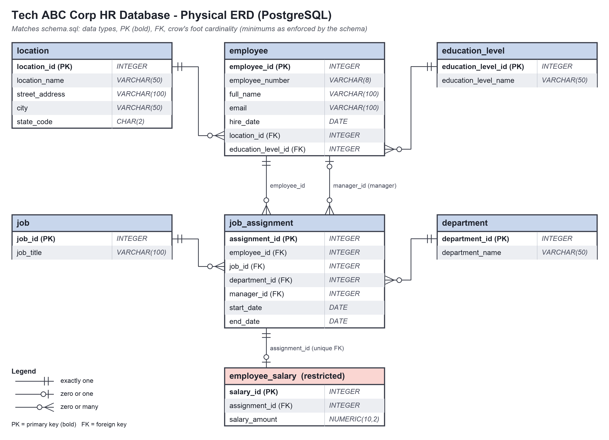

# HR Database Design & Data Migration | PostgreSQL

[](https://github.com/adebowalep/hr-database-design/actions/workflows/tests.yml)


## Project overview
Tech ABC Corp is a fictional company whose HR records live in one spreadsheet-style table (`proj_stg`): one row per employee per job, with salary, manager, office and education repeated on every row. This project designs a normalized PostgreSQL database for it, migrates the spreadsheet data with SQL, keeps each employee's job history, and restricts salary data to authorised roles.

It started as a Udacity Data Architecture course project and was then hardened: a salary-exposure bug was found and fixed, the ETL got data-quality gates, and an automated SQL test suite was added. This is an educational design, not a production HR system.

## What it demonstrates
* **Relational modeling and normalization**: 7 tables in 3NF with primary keys, foreign keys, unique and CHECK constraints, and a self-referencing manager link.
* **SQL ETL**: staging table to normalized tables in one transaction, with preflight checks and a reconciliation step.
* **Historical records**: one `job_assignment` row per job period; the current job has `end_date IS NULL` and the database allows only one per employee.
* **Role-based access control**: explicit least-privilege grants, tested for the staging table, tables and views.
* **Automated testing**: about 180 SQL assertions that check expected SQLSTATE codes and make `psql` exit non-zero on failure.
* **Reproducibility**: a fictional dataset and a guarded reset script, so a clone can rebuild everything.

## Architecture
```
HR spreadsheet (proj_stg)
        |
        v
 etl_check_staging()   data profiling gate: conflicts, ambiguous managers, bad dates (EL001-EL015)
        |
        v
 Cleaning + ETL        trim / collapse spaces, fix city typo, 2100 placeholder -> NULL, resolve managers
        |
        v
 Normalized PostgreSQL (7 tables)
        |
  +-----+-----------+
  |                 |
  v                 v
Queries,         Validation tests
view, procedure  + role-based access (hr_read / hr_staff)
```

## Physical database diagram


The conceptual and logical ERDs are in [docs/erd/](docs/erd/) with editable `.drawio` sources. The generator is `docs/erd/generate_erds.py` (needs Pillow); `tests/35_schema_matches_erd.sql` checks that the live schema matches the physical diagram's tables, columns, types, keys and foreign keys.

## Database design
| Table | Purpose |
|---|---|
| `employee` | One row per person: employee number, name, email, hire date, location, education level |
| `job_assignment` | One row per employee per job period: job, department, manager (another `employee`), start and end date |
| `employee_salary` | Salary per job assignment (restricted table) |
| `job`, `department`, `location`, `education_level` | Lookup tables |

All foreign keys are `ON DELETE RESTRICT`: a referenced row cannot be deleted. That protects integrity; it is not a retention or backup policy (see [docs/backup_and_retention.md](docs/backup_and_retention.md)).

## ETL and data cleaning
[`sql/etl_from_proj_stg.sql`](sql/etl_from_proj_stg.sql) runs as one transaction: if any check fails, the target tables stay empty (tested).
* **Preflight** ([`sql/etl_preflight.sql`](sql/etl_preflight.sql)): fails with a specific SQLSTATE instead of letting `min()` pick among conflicting values. It rejects an Emp_ID with several names, emails, locations or education levels; duplicate emails or names; manager names that match no one or are ambiguous; self-managers and management cycles; overlapping or reversed job periods; several current rows; non-positive salary.
* **Cleaning**: trimmed names, collapsed double spaces, lower-case emails, `Minnapolis` corrected, 2100 end dates stored as `NULL`.
* **Manager resolution**: the source has only manager names, so names must be unique and every name must match exactly one employee (no invented IDs).
* **Hire date**: the course data stores the last job-change date as `hire_dt` for people with history, so `hire_date = earliest of (hire_dt, first start_dt)`.
* **Reconciliation**: staging rows = assignments = salaries; staging employees = employees; no unresolved managers.

## Security and access control
Roles: `hr_read` (ordinary employees, login `NoMgr` is a member), `hr_staff` (HR and management). See [`sql/optional/03_salary_security.sql`](sql/optional/03_salary_security.sql).

**Bug found and fixed.** The first version granted `SELECT` on all tables to `hr_read` and revoked only `employee_salary` and the HR view. The staging table `proj_stg` also holds every salary, so `SELECT salary FROM proj_stg` worked for the read-only user. The fix is an explicit allow-list: `hr_read` gets six named tables and `v_employee_directory`; `proj_stg` is owner-only (kept, because the ETL needs it); both views use `security_invoker`, so a view cannot widen access. Write-up and before/after output: [docs/security/](docs/security/README.md).

| Security tests (`tests/10_security.sql`) | Before fix | After fix |
|---|---|---|
| Original course data, local | 45 pass, 9 fail | 54 pass, 0 fail |

Covered: the read-only role can read the directory but not `employee_salary`, the salary view or `proj_stg`, and cannot write; an unrelated role gets nothing through `PUBLIC`; the HR role can read salary but cannot truncate, drop or read staging. Every denial asserts SQLSTATE `42501`.

## Data validation and tests
`tests/run_tests.sql` runs in one transaction that is always rolled back, so it never changes the database. Categories: reconciliation with staging, keys and integrity, job history, dates, hierarchy, data cleaning, ETL preflight rejections, constraint violations (SQLSTATE asserted), schema vs ERD, queries/views/procedure, security, and dataset-specific expectations.

Latest local results (PostgreSQL 17.11): **synthetic dataset 183 passed, 0 failed; original course dataset 181 passed, 0 failed** (3 informational rows each). The suite was also shown to fail on deliberately corrupted copies. Details, outputs and what was not run: [docs/test_results/](docs/test_results/README.md). `sql/validation_checks.sql` is the older diagnostic report for the course data.

CI: [`.github/workflows/tests.yml`](.github/workflows/tests.yml) builds the database from the **synthetic dataset** and runs the suite on GitHub-hosted Linux runners with PostgreSQL 15, 16 and 17. It also runs the negative controls (the suite must fail on corrupted copies), the ETL atomicity test and the guarded reset-and-rebuild. First verified run (commit `67e0cc8`, 2026-11-18): all three jobs succeeded, see [run 44324800766](https://github.com/adebowalep/hr-database-design/actions/runs/44324800766). The badge above shows the current status of the latest run on `main`. The original course dataset is not available to CI and was tested locally only.

## Reproduce it
Requires PostgreSQL 15+ and `psql` 13+ (a superuser, because the security script creates roles). Run from the repository root; paths work on macOS, Linux and Windows (Git Bash / PowerShell).
```bash
createdb hr_demo
psql -d hr_demo -v ON_ERROR_STOP=1 -f data/synthetic/synthetic_proj_stg.sql   # fictional staging data
psql -d hr_demo -v ON_ERROR_STOP=1 -f sql/run_all.sql                         # schema, ETL, view, procedure, roles, CRUD queries
psql -d hr_demo -v ON_ERROR_STOP=1 -f tests/run_tests.sql                      # exit status 0 = all assertions passed
```
Rebuild a **disposable** database (drops only the HR objects, never `proj_stg`, and needs the exact database name):
```bash
psql -d hr_demo -v confirm_reset=hr_demo -f sql/reset_dev.sql
```
`schema.sql` never drops anything and stops if the tables already exist. Use a throwaway database; the security script creates the roles `hr_read`, `hr_staff` and `NoMgr` at cluster level.

To use the original course data instead, load the course's own `StageTableLoad.sql` into an empty database in place of the synthetic file (it is not redistributed here). The tests detect which dataset is loaded.

## Project structure
```
sql/        schema, ETL + preflight, CRUD queries, optional challenges (view, procedure, security), reset_dev, run_all
tests/      SQL test suite (run_tests.sql) and the ETL atomicity test
data/       synthetic staging data
docs/       ERDs, security write-up, test results, execution evidence (screenshots), slides, backup notes, provenance
.github/    GitHub Actions workflow
```

## Limitations
* Educational design; not deployed anywhere and not a production HR system. Backups, retention and disaster recovery are described, not configured.
* The synthetic dataset is tiny (9 employees) and exercises the logic, not performance. No performance figures are claimed.
* Tested locally on PostgreSQL 17.11 (macOS) and in GitHub Actions on PostgreSQL 15, 16 and 17 (Linux, synthetic data). Windows is untested.
* `NoMgr` has no password; real logins need one. Views use `security_invoker` (PostgreSQL 15+).
* Course-derived screenshots and outputs in `docs/screenshots` show employee names and one salary from the fictional course dataset; see the provenance note. They predate the security fix and are kept as historical evidence.
* Screenshots are PNG renderings of real `psql` output, not OS screen captures.

## Further documentation
* [Security defect, fix and before/after results](docs/security/README.md)
* [Test results](docs/test_results/README.md) and [original validation results](docs/validation_results.md)
* [Backup, retention and recovery notes](docs/backup_and_retention.md)
* [Data provenance and privacy review](docs/PROVENANCE_AND_PRIVACY.md)
* [Presentation slides](docs/presentation/Tech_ABC_Corp_HR_Database.pptx) and [execution evidence](docs/screenshots/)
